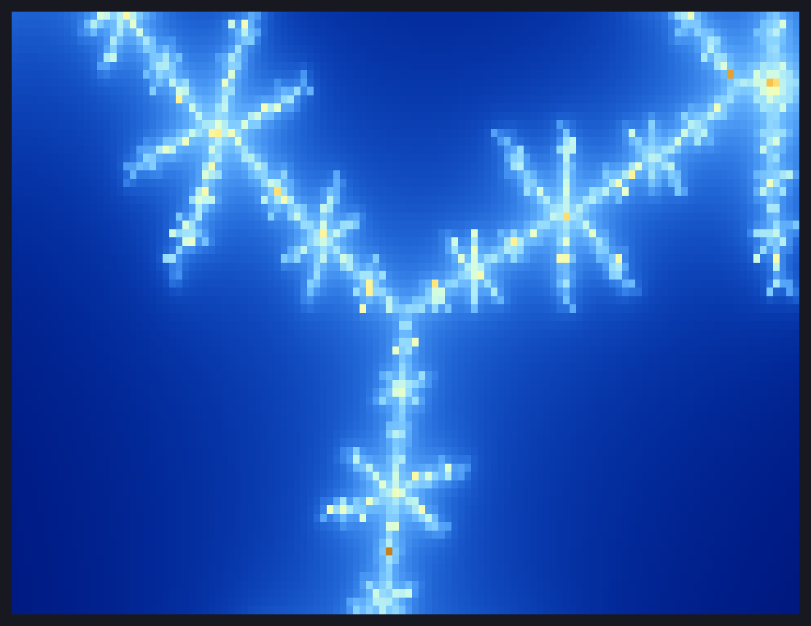
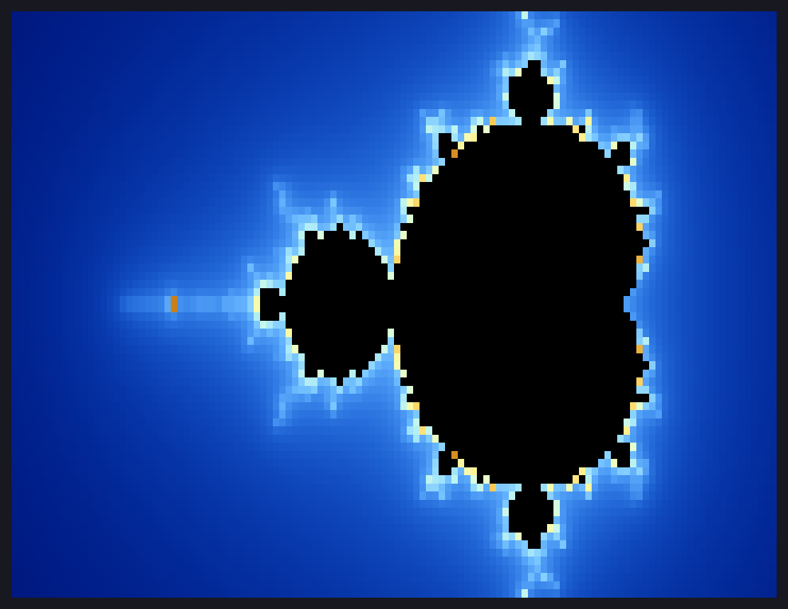
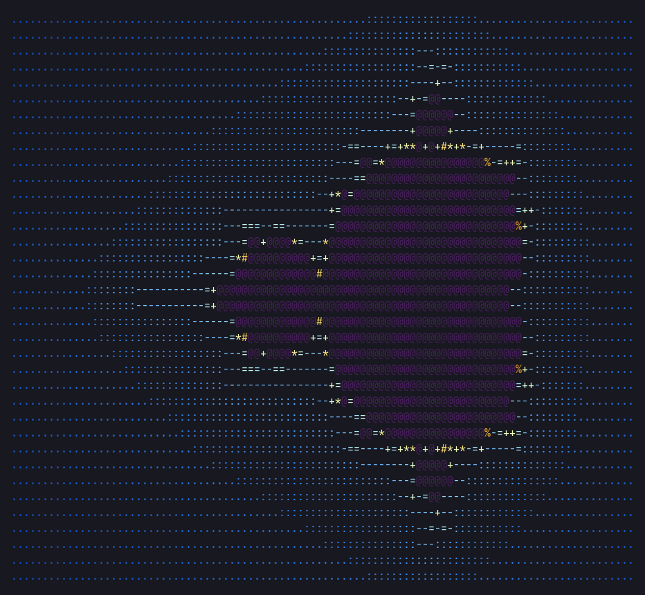
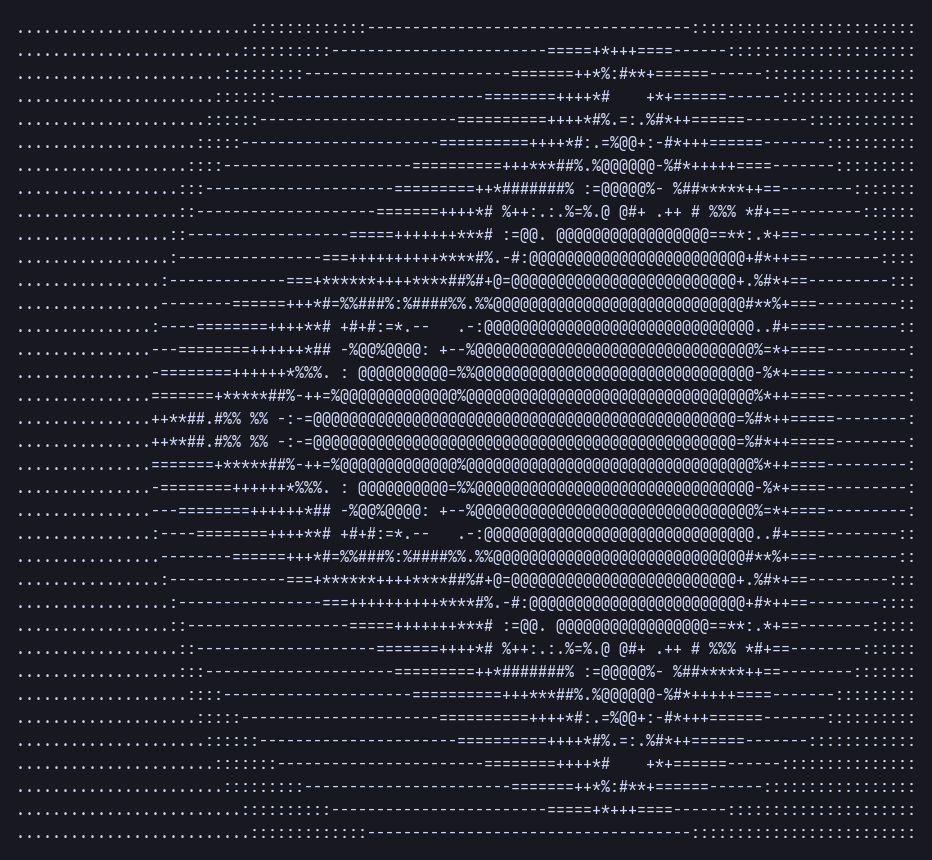

# fractals

Mandelbrot set renderers for the terminal, written in Free Pascal.

There are five programs. Each one builds on the one before it, going from
plain ASCII art to an interactive, multithreaded truecolor explorer.

| Program        | Output                         | What it adds                                                    |
| -------------- | ------------------------------ | --------------------------------------------------------------- |
| `mandelbrot`   | Plain ASCII                    | The basic escape-time algorithm; characters cycle by iteration  |
| `mandelbrot2`  | ASCII gradient                 | Log-scaled character gradient, separate interior character      |
| `mandelbrot3`  | Coloured ASCII (24-bit ANSI)   | Smooth (fractional) escape count and a cosine colour gradient   |
| `mandelbrot4`  | Truecolor half blocks (`▀`)    | Two square pixels per cell, auto contrast, pan and zoom         |
| `mandelbrot5`  | Interactive truecolor explorer | Keyboard pan/zoom, fits the terminal, uses every CPU core       |

## Screenshots

### mandelbrot5: interactive explorer

`./mandelbrot5 120 36 3000 -0.1011 0.9563 300 | cat`: a single frame of
the branching filaments near the top bulb (piped output draws one frame
instead of starting the explorer)



### mandelbrot4: truecolor half blocks

`./mandelbrot4 120 36 1000`



`./mandelbrot4 120 36 2000 -0.7436 0.1318 200`: zoomed into Seahorse Valley


### mandelbrot3: coloured ASCII

`./mandelbrot3 100 36 500`



### mandelbrot2: ASCII gradient

`./mandelbrot2 100 36`


### mandelbrot: plain ASCII

`./mandelbrot 100 36`



The screenshots are each program's real output, drawn to PNG with the
JetBrains Mono font on a dark background by
[`tools/ansi2png.py`](tools/ansi2png.py). To regenerate them all (needs
Python with Pillow, `sudo pacman -S python-pillow`):

```sh
tools/screenshots.sh                                  # default font
tools/screenshots.sh --font /path/to/SomeMono.ttf     # another monospace font
```

To render any command's colour output yourself, either name the command
after `--` or pipe its output in:

```sh
tools/ansi2png.py out.png -- ./mandelbrot4 160 50 3000 -0.1011 0.9563 300
./mandelbrot4 160 50 3000 -0.1011 0.9563 300 | tools/ansi2png.py out.png
```

In `mandelbrot5`, pressing `s` does this for the view on screen.

## Requirements

- [Free Pascal](https://www.freepascal.org/) 3.x. On Arch Linux:
  `sudo pacman -S fpc`
- For `mandelbrot3`, `mandelbrot4` and `mandelbrot5`, a terminal with
  24-bit colour (kitty, alacritty, foot, wezterm, ...). `mandelbrot4` and
  `mandelbrot5` also need a font with the `▀` (U+2580) character, which
  almost every monospace font has.
- `mandelbrot5` is Linux only (it uses termios and `sysconf`).

## Building

Build one program:

```sh
fpc -O2 mandelbrot4.pas
```

`mandelbrot5` links against libc for threading, so `fpc` prints two
harmless warnings about `crtbeginS.o` and `crtendS.o` not being found. The
program still links and runs.

Or build them all:

```sh
for f in mandelbrot*.pas; do fpc -O2 "$f"; done
```

## Usage

Every program supports `-h` / `--help`.

### mandelbrot, mandelbrot2, mandelbrot3

```sh
./mandelbrot3 [width] [height] [max_iterations]
```

| Argument         | Meaning          | Default |
| ---------------- | ---------------- | ------- |
| `width`          | output columns   | 100     |
| `height`         | output rows      | 40      |
| `max_iterations` | iteration limit  | 200     |

### mandelbrot4

```sh
./mandelbrot4 [width] [rows] [max_iter] [centre_x] [centre_y] [zoom]
```

| Argument   | Meaning                                   | Default |
| ---------- | ----------------------------------------- | ------- |
| `width`    | terminal columns                          | 120     |
| `rows`     | terminal rows (pixel height is 2 × rows)  | 40      |
| `max_iter` | iteration limit                           | 500     |
| `centre_x` | real part of the view centre              | -0.75   |
| `centre_y` | imaginary part of the view centre         | 0       |
| `zoom`     | magnification; 1 shows the whole set      | 1       |

Some views to try:

```sh
./mandelbrot4 $(tput cols) $(($(tput lines)-1)) 1000    # fill the terminal
./mandelbrot4 160 50 2000 -0.7436 0.1318 200            # Seahorse Valley
./mandelbrot4 160 50 3000 -0.1011 0.9563 300            # spiral near the top bulb
```

Deep zooms need a higher `max_iter` to bring out detail near the edge of
the set.

### mandelbrot5

```sh
./mandelbrot5 [width] [rows] [max_iter] [centre_x] [centre_y] [zoom]
```

The arguments are the same as `mandelbrot4`'s, except that `width` and
`rows` default to 0, which means "fit the terminal" (one row is kept for a
status line). The view then follows the terminal when it is resized.

| Key                 | Action                                           |
| ------------------- | ------------------------------------------------ |
| arrows, `h j k l`   | pan by a tenth of the view                       |
| `+` / `=`           | zoom in (×1.5)                                   |
| `-` / `_`           | zoom out                                         |
| `]` / `[`           | more / fewer iterations (×1.5)                   |
| `s`                 | save the view as `mandelbrot-DATE-TIME.png`      |
| `r`                 | reset to the whole set                           |
| `q`, Esc, Ctrl-C    | quit                                             |

The status line shows the centre, zoom, iteration limit, how long the last
frame took and the thread count. It warns when the zoom is so deep that
double precision can no longer tell neighbouring pixels apart. On quit,
the program prints a command line that reopens the same view.

```sh
./mandelbrot5                                  # explore from the whole set
./mandelbrot5 0 0 2000 -0.7436 0.1318 200      # start in Seahorse Valley
./mandelbrot5 160 50 3000 -0.1011 0.9563 300 > view.ans     # save one frame
```

When its output isn't a terminal, `mandelbrot5` draws one frame (120×40
unless given) and exits, producing exactly the same output as
`mandelbrot4` with the same arguments.

Rendering uses one thread per online CPU. Set `MANDELBROT_THREADS` to
change that, for example `MANDELBROT_THREADS=1` to compare speeds.

Pressing `s` pipes the frame on screen (without the status line) through
`tools/ansi2png.py`. The PNG is written to the current directory, and the
status line shows its name or the error. This needs `python3` with Pillow.
The script is looked for in `tools/` next to the `mandelbrot5` binary; set
`MANDELBROT_ANSI2PNG` to its path if you run a copy of the binary from
somewhere else.

## How it works

Each pixel is a point *c* in the complex plane. The program repeats
*z ← z² + c*, starting from *z = 0*. If |*z*| stays bounded for
`max_iter` steps, *c* is treated as inside the set. Otherwise the number
of steps it took to escape decides the pixel's character or colour.

- **mandelbrot2** spreads `ln(iterations)` across the palette, so the
  gradient is smooth rather than wrapping round.
- **mandelbrot3** and **mandelbrot4** use a large escape radius and the
  fractional count `n + 1 − log₂(log|z|)`, which removes visible colour
  bands.
- **mandelbrot4** works out every pixel first, then stretches the gradient
  between the lowest and highest values on screen, so zoomed-in views keep
  full contrast.
- **mandelbrot5** shares rows out between a pool of worker threads, both
  for working out pixels and for building the output. It also spots points
  in the main cardioid and the period-2 bulb with a direct formula. Those
  points never escape, so this skips the most expensive pixels in the
  picture. A 400×120 frame of the whole set at 20000 iterations drops from
  about 2.4 s with `mandelbrot4` to about 0.35 s on a 2-core/4-thread
  laptop.

## License

MIT. See [LICENSE.md](LICENSE.md).
