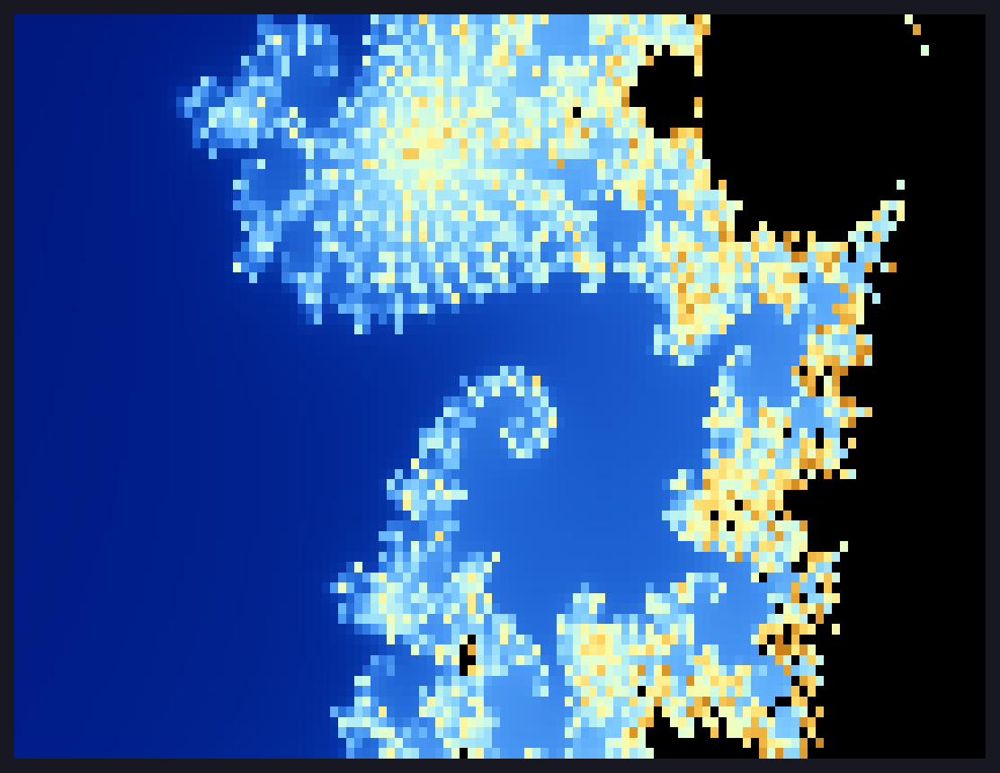
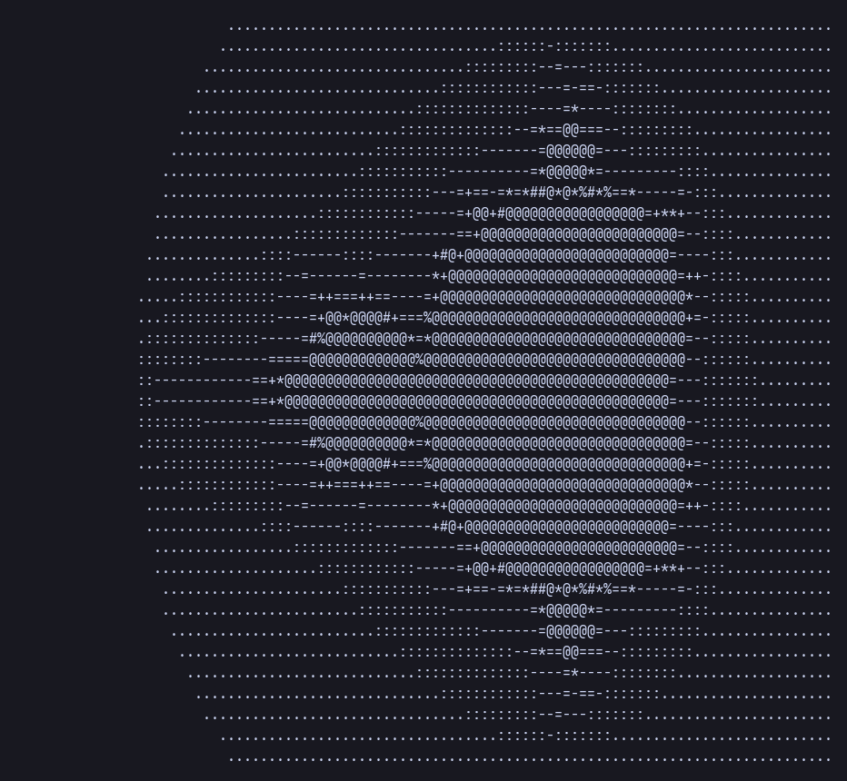
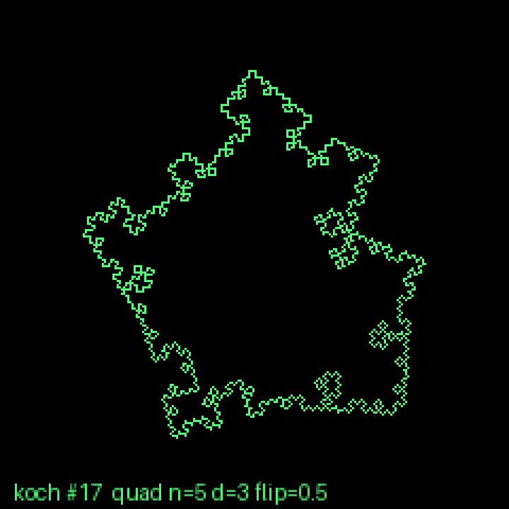
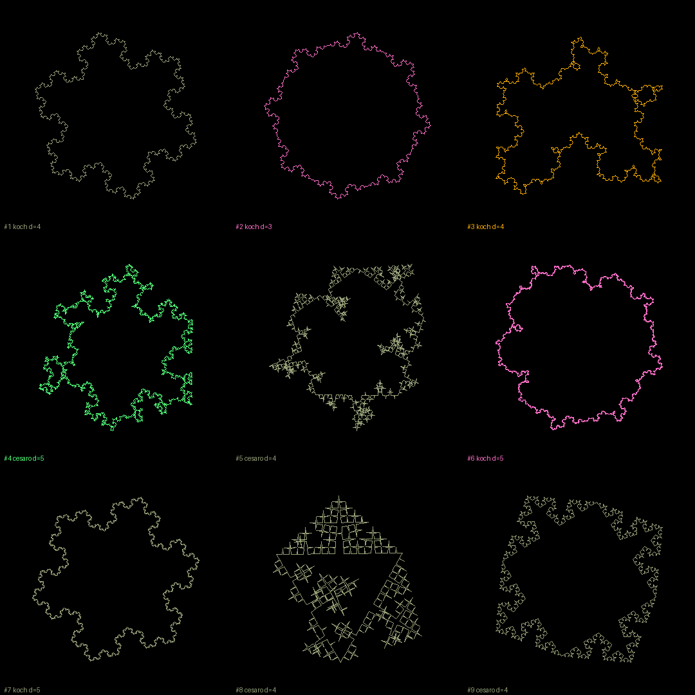
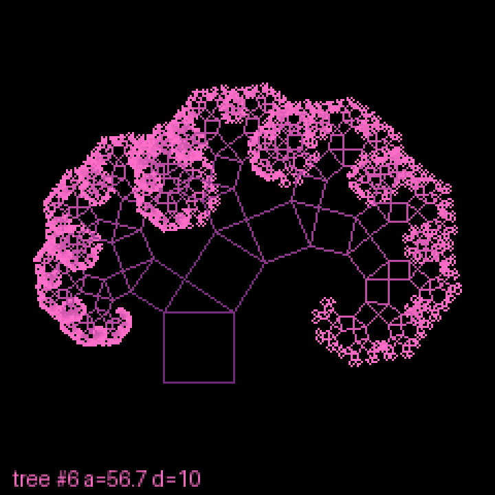
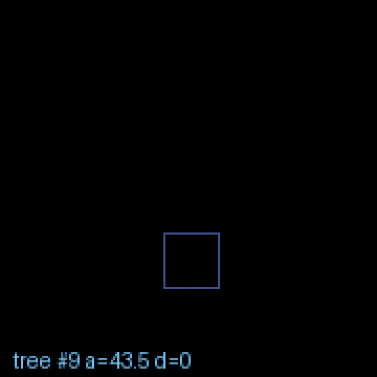
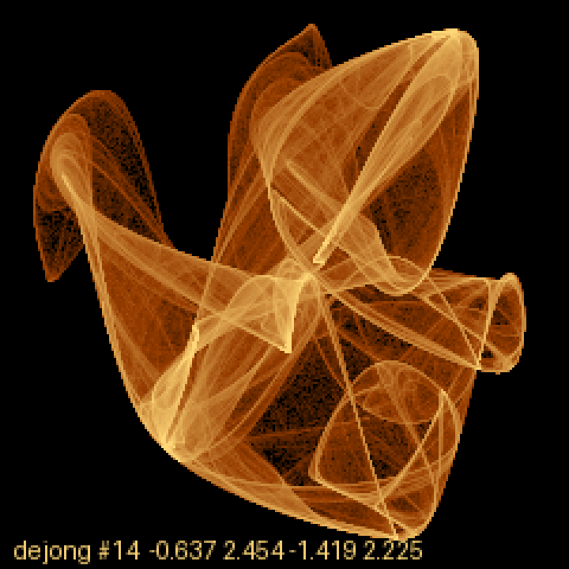
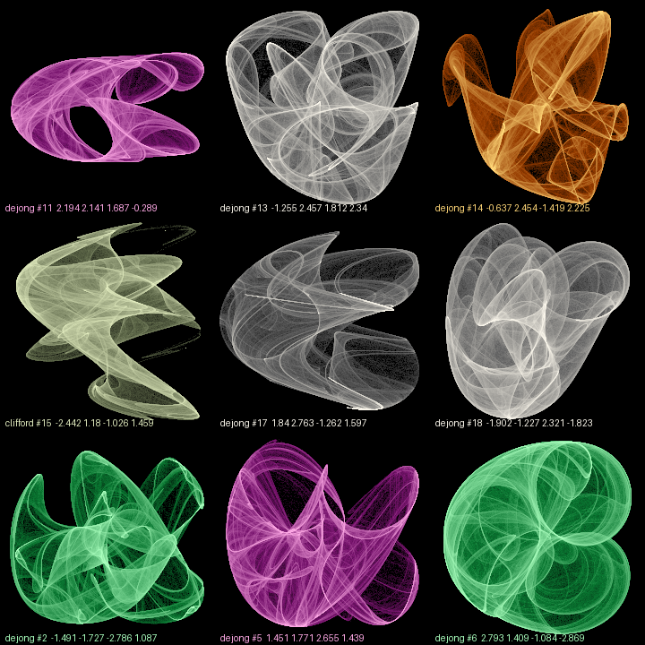
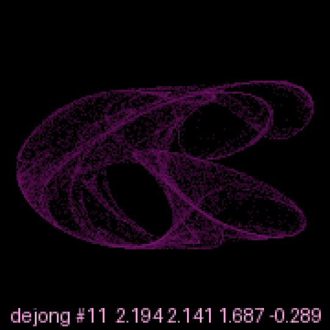

# fractals

Fractal toys in two languages:

- [`pascal/`](pascal/): Mandelbrot set renderers for the terminal, written
  in Free Pascal (most of this README).
- [`python/`](python/): seeded Koch-curve, Pythagoras-tree and
  strange-attractor image generators that write retro-styled PNGs and
  animated GIFs (see [Python scripts](#python-scripts)), plus a Mandelbrot
  deep-zoom video renderer (see [Mandelbrot zoom video](#mandelbrot-zoom-video)).

There are five Pascal programs. Each one builds on the one before it, going
from plain ASCII art to an interactive, multithreaded truecolor explorer.
Their sources, `Makefile` and tools live in `pascal/`, and every Pascal
command in this README is run from that directory (`cd pascal` first).

| Program        | Output                         | What it adds                                                    |
| -------------- | ------------------------------ | --------------------------------------------------------------- |
| `mandelbrot`   | Plain ASCII                    | The basic escape-time algorithm; characters cycle by iteration  |
| `mandelbrot2`  | ASCII gradient                 | Log-scaled character gradient, separate interior character      |
| `mandelbrot3`  | Coloured ASCII (24-bit ANSI)   | Smooth (fractional) escape count and a cosine colour gradient   |
| `mandelbrot4`  | Truecolor half blocks (`▀`)    | Two square pixels per cell, auto contrast, pan and zoom         |
| `mandelbrot5`  | Interactive truecolor explorer | Keyboard pan/zoom, fits the terminal, uses every CPU core       |

## Screenshots

### mandelbrot5: interactive explorer

`./mandelbrot5 120 36 3000 -0.1011 0.9563 300 | cat`: a single frame of
the branching filaments near the top bulb (piped output draws one frame
instead of starting the explorer)


### mandelbrot4: truecolor half blocks

`./mandelbrot4 120 36 1000`


`./mandelbrot4 120 36 2000 -0.7436 0.1318 200`: zoomed into Seahorse Valley



### mandelbrot3: coloured ASCII

`./mandelbrot3 100 36 500`


### mandelbrot2: ASCII gradient

`./mandelbrot2 100 36`



### mandelbrot: plain ASCII

`./mandelbrot 100 36`


The screenshots are each program's real output, drawn to PNG with the
JetBrains Mono font on a dark background by
[`tools/ansi2png.py`](pascal/tools/ansi2png.py). To regenerate them all (needs
Python with Pillow, `sudo pacman -S python-pillow`):

```sh
make screenshots                                      # default font
tools/screenshots.sh --font /path/to/SomeMono.ttf     # another monospace font
```

To render any command's colour output yourself, either name the command
after `--` or pipe its output in:

```sh
tools/ansi2png.py out.png -- ./mandelbrot4 160 50 3000 -0.1011 0.9563 300
./mandelbrot4 160 50 3000 -0.1011 0.9563 300 | tools/ansi2png.py out.png
```

In `mandelbrot5`, pressing `s` does this for the view on screen.

## Requirements

- [Free Pascal](https://www.freepascal.org/) 3.x. On Arch Linux:
  `sudo pacman -S fpc`
- For `mandelbrot3`, `mandelbrot4` and `mandelbrot5`, a terminal with
  24-bit colour (kitty, alacritty, foot, wezterm, ...). `mandelbrot4` and
  `mandelbrot5` also need a font with the `▀` (U+2580) character, which
  almost every monospace font has.
- `mandelbrot5` is Linux only (it uses termios and `sysconf`).

## Building

```sh
cd pascal
make                # build every program
make mandelbrot4    # build one
make check          # quick tests (below)
make screenshots    # regenerate the README screenshots
make clean          # remove binaries and build output
```

Without `make`, build a program directly with `fpc -O2 mandelbrot4.pas`.

`mandelbrot5` links against libc for threading, so `fpc` prints two
harmless warnings about `crtbeginS.o` and `crtendS.o` not being found. The
program still links and runs.

`make check` runs every program with `--help` and at 1×1. It also checks
that piped `mandelbrot5` output matches `mandelbrot4` byte for byte across
a set of views, including odd arguments.

## Usage

Every program supports `-h` / `--help`.

### mandelbrot, mandelbrot2, mandelbrot3

```sh
./mandelbrot3 [width] [height] [max_iterations]
```

| Argument         | Meaning          | Default |
| ---------------- | ---------------- | ------- |
| `width`          | output columns   | 100     |
| `height`         | output rows      | 40      |
| `max_iterations` | iteration limit  | 200     |

### mandelbrot4

```sh
./mandelbrot4 [width] [rows] [max_iter] [centre_x] [centre_y] [zoom]
```

| Argument   | Meaning                                   | Default |
| ---------- | ----------------------------------------- | ------- |
| `width`    | terminal columns                          | 120     |
| `rows`     | terminal rows (pixel height is 2 × rows)  | 40      |
| `max_iter` | iteration limit                           | 500     |
| `centre_x` | real part of the view centre              | -0.75   |
| `centre_y` | imaginary part of the view centre         | 0       |
| `zoom`     | magnification; 1 shows the whole set      | 1       |

Some views to try:

```sh
./mandelbrot4 $(tput cols) $(($(tput lines)-1)) 1000    # fill the terminal
./mandelbrot4 160 50 2000 -0.7436 0.1318 200            # Seahorse Valley
./mandelbrot4 160 50 3000 -0.1011 0.9563 300            # spiral near the top bulb
```

Deep zooms need a higher `max_iter` to bring out detail near the edge of
the set.

### mandelbrot5

```sh
./mandelbrot5 [width] [rows] [max_iter] [centre_x] [centre_y] [zoom]
```

The arguments are the same as `mandelbrot4`'s, except that `width` and
`rows` default to 0, which means "fit the terminal" (one row is kept for a
status line). The view then follows the terminal when it is resized.

| Key                 | Action                                           |
| ------------------- | ------------------------------------------------ |
| arrows, `h j k l`   | pan by a tenth of the view                       |
| `+` / `=`           | zoom in (×1.5)                                   |
| `-` / `_`           | zoom out                                         |
| `]` / `[`           | more / fewer iterations (×1.5)                   |
| `s`                 | save the view as `mandelbrot-DATE-TIME.png`      |
| `r`                 | reset to the whole set                           |
| `q`, Esc, Ctrl-C    | quit                                             |

The status line shows the centre, zoom, iteration limit, how long the last
frame took and the thread count. It warns when the zoom is so deep that
double precision can no longer tell neighbouring pixels apart. On quit,
the program prints a command line that reopens the same view.

```sh
./mandelbrot5                                  # explore from the whole set
./mandelbrot5 0 0 2000 -0.7436 0.1318 200      # start in Seahorse Valley
./mandelbrot5 160 50 3000 -0.1011 0.9563 300 > view.ans     # save one frame
```

When its output isn't a terminal, `mandelbrot5` draws one frame (120×40
unless given) and exits, producing exactly the same output as
`mandelbrot4` with the same arguments.

Rendering uses one thread per online CPU. Set `MANDELBROT_THREADS` to
change that, for example `MANDELBROT_THREADS=1` to compare speeds.

Pressing `s` pipes the frame on screen (without the status line) through
`tools/ansi2png.py`. The PNG is written to the current directory, and the
status line shows its name or the error. This needs `python3` with Pillow.
The script is looked for in `tools/` next to the `mandelbrot5` binary; set
`MANDELBROT_ANSI2PNG` to its path if you run a copy of the binary from
somewhere else.

## How it works

Each pixel is a point *c* in the complex plane. The program repeats
*z ← z² + c*, starting from *z = 0*. If |*z*| stays bounded for
`max_iter` steps, *c* is treated as inside the set. Otherwise the number
of steps it took to escape decides the pixel's character or colour.

- **mandelbrot2** spreads `ln(iterations)` across the palette, so the
  gradient is smooth rather than wrapping round.
- **mandelbrot3** and **mandelbrot4** use a large escape radius and the
  fractional count `n + 1 − log₂(log|z|)`, which removes visible colour
  bands.
- **mandelbrot4** works out every pixel first, then stretches the gradient
  between the lowest and highest values on screen, so zoomed-in views keep
  full contrast.
- **mandelbrot5** shares rows out between a pool of worker threads, both
  for working out pixels and for building the output. It also spots points
  in the main cardioid and the period-2 bulb with a direct formula. Those
  points never escape, so this skips the most expensive pixels in the
  picture. A 400×120 frame of the whole set at 20000 iterations drops from
  about 2.4 s with `mandelbrot4` to about 0.35 s on a 2-core/4-thread
  laptop.

## Python scripts

Three standalone scripts in `python/` draw fractals as images. All of them
need Python 3 with Pillow (`sudo pacman -S python-pillow`), and
`attractor.py` also needs NumPy (`sudo pacman -S python-numpy`). They write
their output to the current directory. The commands below are run from the
repo root.

| Script               | Draws                                                               |
| -------------------- | ------------------------------------------------------------------- |
| `koch_riff.py`       | Koch-style curves on a 3–8 sided polygon: classic, Cesàro or square bumps, flipped in or out at random |
| `pythagoras_tree.py` | Pythagoras trees of squares and right triangles, with varied branch angle, wobble and lean |
| `attractor.py`       | Clifford and de Jong strange attractors as glowing density plots    |

Each image comes from a **seed**. The seed picks the shape (or the
attractor's parameters), depth and colour palette (amber CRT, green
phosphor, ice, and so on), so the same seed always gives the same picture. A seed can be a number or any text, and a
random one is used if you don't give any. The script prints each seed's
settings as it goes.

```sh
python3 python/koch_riff.py [--gif] [--sheet] [--size WxH|N] [seed ...]
python3 python/pythagoras_tree.py [--gif] [--sheet] [--size WxH|N] [seed ...]
python3 python/attractor.py [--gif] [--sheet] [--size WxH|N] [seed ...]
```

| Option         | Effect                                                                         |
| -------------- | ------------------------------------------------------------------------------ |
| *(none)*       | One PNG per seed: `koch_SEED.png` / `tree_SEED.png` / `attractor_SEED.png`     |
| `--gif`        | Animate the fractal growing one depth at a time (for attractors, the points piling up), as a looping GIF |
| `--sheet`      | A contact sheet with 3 columns of every seed (9 random ones if none given), saved as `sheet_SEEDS.png` / `sheet_tree_SEEDS.png` / `sheet_attractor_SEEDS.png` |
| `--size WxH`   | Output size in pixels, or `N` for N×N (default 1080×1080). For `--sheet` this is the whole sheet |

`--gif` and `--sheet` can be combined, giving an animated sheet where every
tile grows in step. `attractor.py --sheet` always writes both the still
`.png` and the animated `.gif`. Single images are drawn at a third of the
size and scaled up with nearest-neighbour, which gives the chunky, low-res
look.
Sheet tiles are drawn at full resolution.

`attractor.py` iterates one of these maps from 20,000 random starting
points, 300 steps each, and counts how many points land in each pixel:

- Clifford: *x′ = sin(a·y) + c·cos(a·x)*, *y′ = sin(b·x) + d·cos(b·y)*
- de Jong: *x′ = sin(a·y) − cos(b·x)*, *y′ = sin(c·x) − cos(d·y)*

The counts are log-scaled and coloured from black through the palette's mid
colour to its hot colour. Parameters that collapse to a few dots are
rejected and re-rolled. Each image takes a second or two.

Examples:

```sh
python3 python/koch_riff.py 42                   # koch_42.png
python3 python/koch_riff.py --gif hello          # a text seed, animated
python3 python/pythagoras_tree.py --sheet        # 9 random trees on one sheet
python3 python/pythagoras_tree.py --sheet --gif --size 1920x1080 1 2 3 4 5 6
python3 python/attractor.py --gif 42             # attractor_42.gif
```

### Example images

These are made by
[`python/screenshots.sh`](python/screenshots.sh), which renders them into
`python/screenshots/`. Run it again to regenerate them all (it takes about
25 seconds).

#### koch_riff.py

`koch_riff.py --size 720 17`: a pentagon with square bumps



`koch_riff.py --sheet 1 2 3 4 5 6 7 8 9`



#### pythagoras_tree.py

`pythagoras_tree.py --size 720 6`



`pythagoras_tree.py --gif --size 540 9`: growing one level at a time



#### attractor.py

`attractor.py --size 720 14`



`attractor.py --sheet --size 720 11 13 14 15 17 18 2 5 6`



`attractor.py --gif --size 540 11`: points piling up



### Mandelbrot zoom video

`zoom_video.py` renders an MP4 that dives from the whole Mandelbrot set to
the spot used by the Andromeda Research demo (−1.74747070750 +
0.00087953063i, magnification 11.1 million). It uses the edge-band look of
`andromeda_zoom.py`: only the boundaries between iteration bands are drawn,
coloured by iteration count, on black. Each frame is rendered at 640×480 and
scaled up 2× with nearest-neighbour, giving a 1280×960, 30 fps video.

It needs NumPy, Numba, Pillow and `ffmpeg` (`sudo pacman -S ffmpeg`). The
Python packages are listed in `python/requirements.txt`, so a virtual
environment is the easiest way to get them:

```sh
cd python
python3 -m venv .venv
.venv/bin/pip install -r requirements.txt
source .venv/bin/activate
```

Then, from `python/`:

```sh
python zoom_video.py                                   # mandel_zoom.mp4, 20 s
python zoom_video.py --turns 1 -o mandel_zoom_spin.mp4  # one clockwise turn
python zoom_video.py --turns 1 --roundtrip -o mandel_roundtrip.mp4  # in and back out, loops
python zoom_video.py --preview 0 0.5 0.8 1             # PNG stills at those points
```

| Option        | Effect                                                                    |
| ------------- | ------------------------------------------------------------------------- |
| `--turns N`   | Rotate the view clockwise N times over the video (default 0)              |
| `--roundtrip` | Zoom in, then back out (twice as long). The rotation keeps going the same way, so the video loops |
| `--preview U ...` | Instead of a video, save `preview_U.png` stills at points U along the zoom (0 = start, 1 = end) |
| `-o FILE`     | Output file (default `mandel_zoom.mp4`)                                   |

The zoom speed is exponential with a smooth start and stop, and the centre
glides onto the target during the first 30% of the dive. The iteration limit
rises from 300 to 1356 as the view narrows. The palette blends from log-scaled
(wide views) to linear (deep views), and each frame's colour range is smoothed
over neighbouring frames so the colours don't flicker.

Rendering takes two passes. The first renders every frame with Numba across
all cores, keeps the iteration counts in a temporary `.iters.tmp` file next to
the output (about 370 MB for the default video, deleted afterwards), and
works out each frame's colour range in worker threads. The second colours the
frames in parallel and pipes them to `ffmpeg`. On a 2-core / 4-thread laptop
the default video takes about 30 seconds and the round trip about a minute.
`ZOOM_WORKERS=N` sets the number of worker threads (default: CPU count).

`andromeda_zoom.py` renders a single still in the same style:

```sh
python andromeda_zoom.py                               # andromeda_zoom.png at the target
python andromeda_zoom.py --cx -0.65 --cy 0 --mag 0.9 --iter 300 --log -o whole.png
```

## License

MIT. See [LICENSE.md](LICENSE.md).
