# fractals

**Contents**

- [Screenshots](#screenshots)
  - [mandelbrot5: interactive explorer](#mandelbrot5-interactive-explorer)
  - [mandelbrot4: truecolor half blocks](#mandelbrot4-truecolor-half-blocks)
  - [mandelbrot3: coloured ASCII](#mandelbrot3-coloured-ascii)
  - [mandelbrot2: ASCII gradient](#mandelbrot2-ascii-gradient)
  - [mandelbrot: plain ASCII](#mandelbrot-plain-ascii)
- [Requirements](#requirements)
- [Building](#building)
- [Usage](#usage)
  - [mandelbrot, mandelbrot2, mandelbrot3](#mandelbrot-mandelbrot2-mandelbrot3)
  - [mandelbrot4](#mandelbrot4)
  - [mandelbrot5](#mandelbrot5)
- [How it works](#how-it-works)
- [Python scripts](#python-scripts)
  - [Example images](#example-images)
  - [Mandelbrot zoom video](#mandelbrot-zoom-video)
- [BBC Micro BASIC](#bbc-micro-basic)
  - [MANDEL3: ECF shading on the Master 128](#mandel3-ecf-shading-on-the-master-128)
  - [MANDEL4: 6502 assembler](#mandel4-6502-assembler)
- [Commodore 64 BASIC](#commodore-64-basic)
- [Blog posts](#blog-posts)
- [Links](#links)
- [License](#license)

Fractal toys in three languages:

- [`pascal/`](pascal/): Mandelbrot set renderers for the terminal, written
  in Free Pascal (most of this README).
- [`python/`](python/): seeded Koch-curve, Pythagoras-tree and
  strange-attractor image generators that write retro-styled PNGs and
  animated GIFs (see [Python scripts](#python-scripts)), plus a Mandelbrot
  deep-zoom video renderer (see [Mandelbrot zoom video](#mandelbrot-zoom-video)).
- [`bbc/`](bbc/): Mandelbrot sets in BBC BASIC for the BBC Micro, drawn in
  MODE 2 (see [BBC Micro BASIC](#bbc-micro-basic)).
- [`c64/`](c64/): Mandelbrot sets in Commodore BASIC V2 for the C64, drawn
  in multicolour bitmap mode (see [Commodore 64 BASIC](#commodore-64-basic)).

There are five Pascal programs. Each one builds on the one before it, going
from plain ASCII art to an interactive, multithreaded truecolor explorer.
Their sources, `Makefile` and tools live in `pascal/`, and every Pascal
command in this README is run from that directory (`cd pascal` first).

| Program        | Output                         | What it adds                                                    |
| -------------- | ------------------------------ | --------------------------------------------------------------- |
| `mandelbrot`   | Plain ASCII                    | The basic escape-time algorithm; characters cycle by iteration  |
| `mandelbrot2`  | ASCII gradient                 | Log-scaled character gradient, separate interior character      |
| `mandelbrot3`  | Coloured ASCII (24-bit ANSI)   | Smooth (fractional) escape count and a cosine colour gradient   |
| `mandelbrot4`  | Truecolor half blocks (`▀`)    | Two square pixels per cell, auto contrast, pan and zoom         |
| `mandelbrot5`  | Interactive truecolor explorer | Keyboard pan/zoom, fits the terminal, uses every CPU core       |

## Screenshots

### mandelbrot5: interactive explorer

`./mandelbrot5 120 36 3000 -0.1011 0.9563 300 | cat`: a single frame of
the branching filaments near the top bulb (piped output draws one frame
instead of starting the explorer)

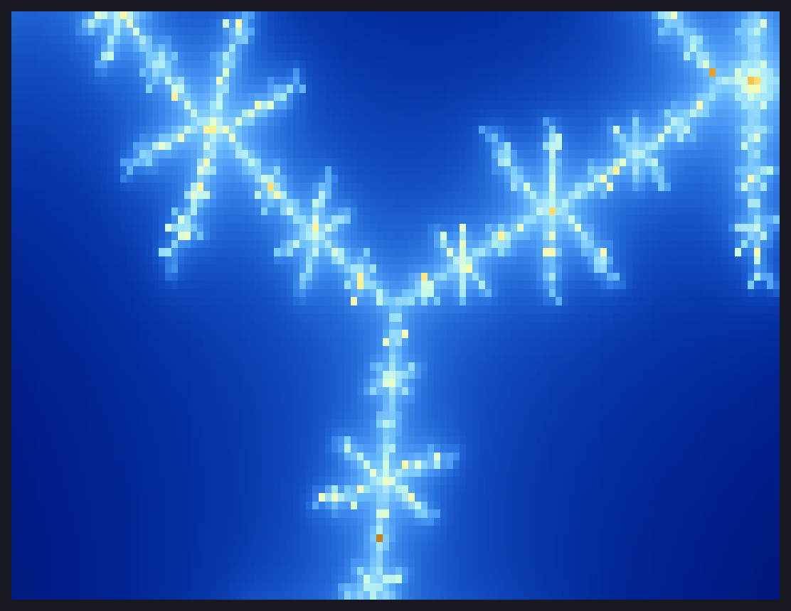

### mandelbrot4: truecolor half blocks

`./mandelbrot4 120 36 1000`

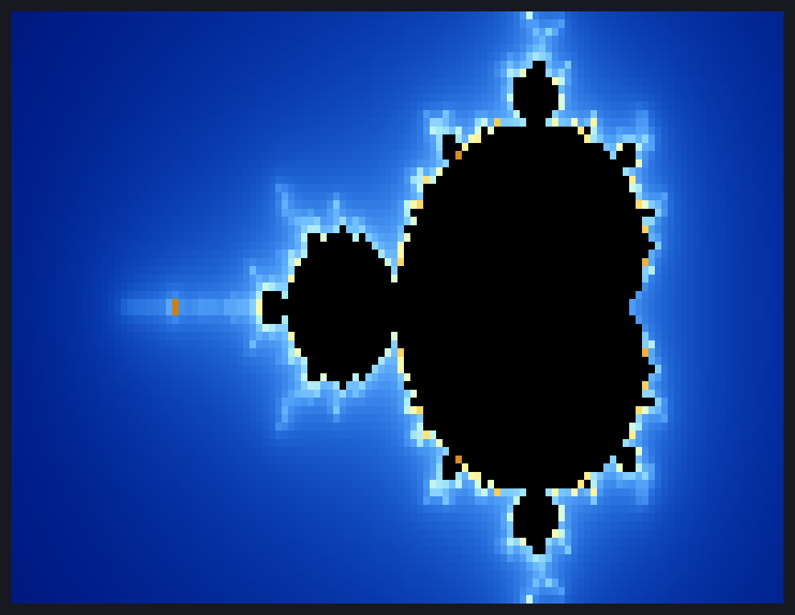

`./mandelbrot4 120 36 2000 -0.7436 0.1318 200`: zoomed into Seahorse Valley

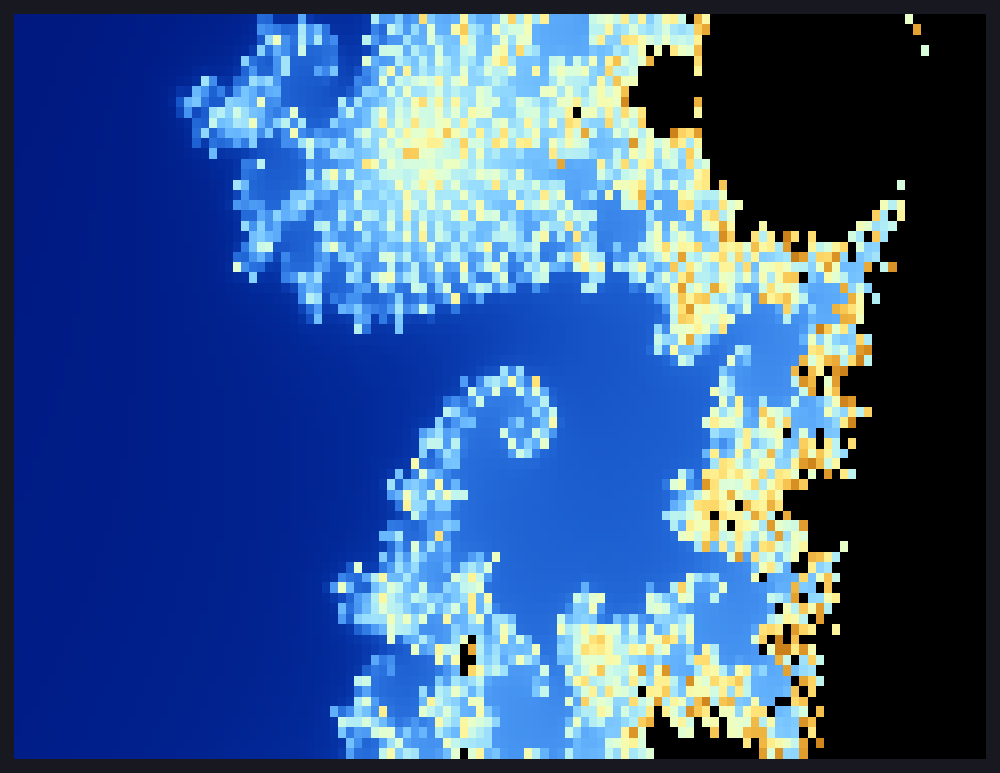

### mandelbrot3: coloured ASCII

`./mandelbrot3 100 36 500`

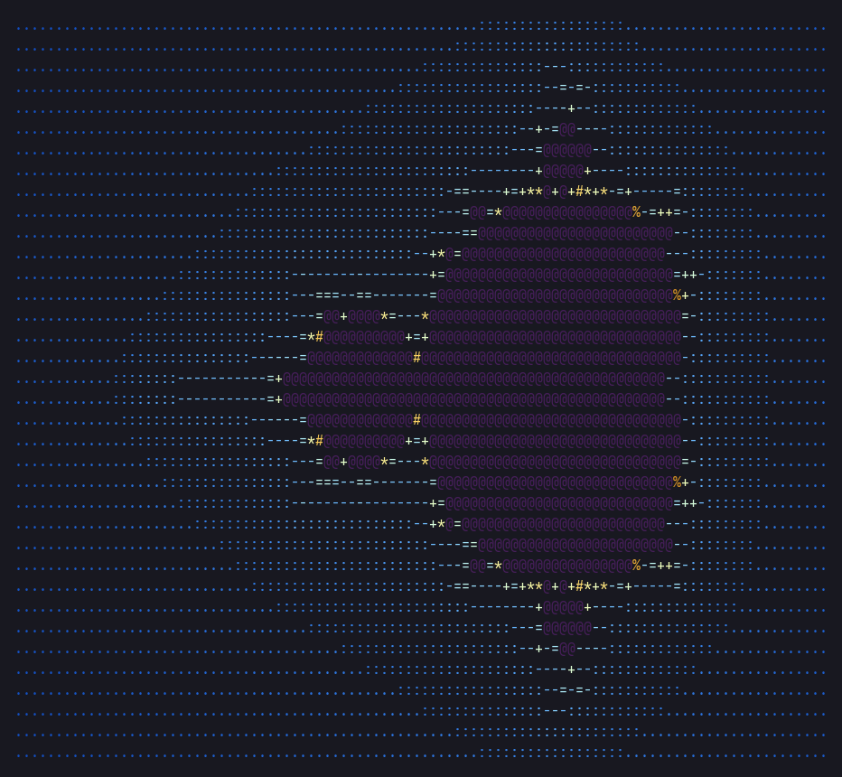

### mandelbrot2: ASCII gradient

`./mandelbrot2 100 36`

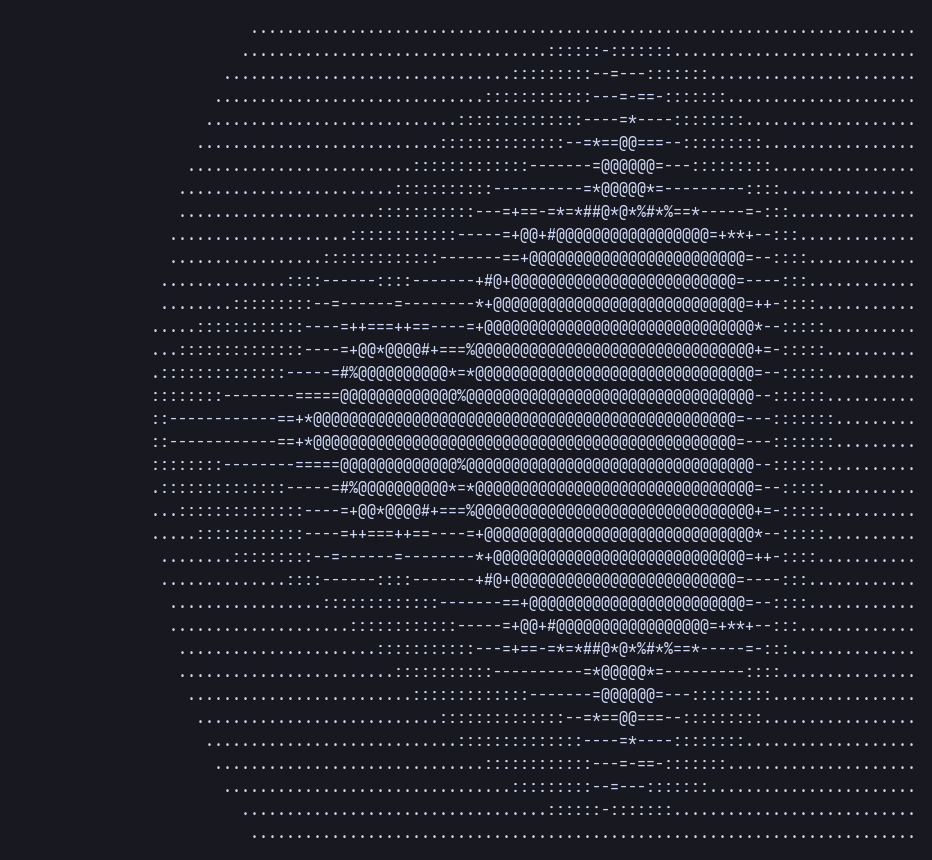

### mandelbrot: plain ASCII

`./mandelbrot 100 36`

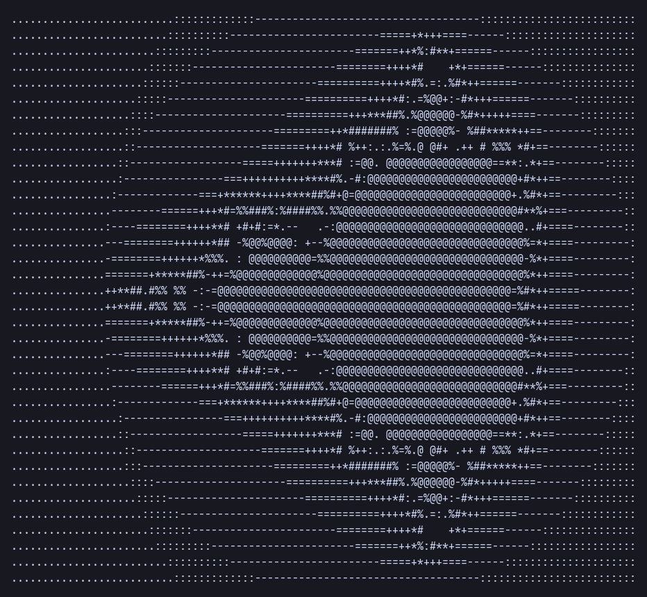

The screenshots are each program's real output, drawn to PNG with the
JetBrains Mono font on a dark background by
[`tools/ansi2png.py`](pascal/tools/ansi2png.py). To regenerate them all (needs
Python with Pillow, `sudo pacman -S python-pillow`):

```sh
make screenshots                                      # default font
tools/screenshots.sh --font /path/to/SomeMono.ttf     # another monospace font
```

To render any command's colour output yourself, either name the command
after `--` or pipe its output in:

```sh
tools/ansi2png.py out.png -- ./mandelbrot4 160 50 3000 -0.1011 0.9563 300
./mandelbrot4 160 50 3000 -0.1011 0.9563 300 | tools/ansi2png.py out.png
```

In `mandelbrot5`, pressing `s` does this for the view on screen.

## Requirements

- [Free Pascal](https://www.freepascal.org/) 3.x. On Arch Linux:
  `sudo pacman -S fpc`
- For `mandelbrot3`, `mandelbrot4` and `mandelbrot5`, a terminal with
  24-bit colour (kitty, alacritty, foot, wezterm, ...). `mandelbrot4` and
  `mandelbrot5` also need a font with the `▀` (U+2580) character, which
  almost every monospace font has.
- `mandelbrot5` is Linux only (it uses termios and `sysconf`).

## Building

```sh
cd pascal
make                # build every program
make mandelbrot4    # build one
make check          # quick tests (below)
make screenshots    # regenerate the README screenshots
make clean          # remove binaries and build output
```

Without `make`, build a program directly with `fpc -O2 mandelbrot4.pas`.

`mandelbrot5` links against libc for threading, so `fpc` prints two
harmless warnings about `crtbeginS.o` and `crtendS.o` not being found. The
program still links and runs.

`make check` runs every program with `--help` and at 1×1. It also checks
that piped `mandelbrot5` output matches `mandelbrot4` byte for byte across
a set of views, including odd arguments.

## Usage

Every program supports `-h` / `--help`.

### mandelbrot, mandelbrot2, mandelbrot3

```sh
./mandelbrot3 [width] [height] [max_iterations]
```

| Argument         | Meaning          | Default |
| ---------------- | ---------------- | ------- |
| `width`          | output columns   | 100     |
| `height`         | output rows      | 40      |
| `max_iterations` | iteration limit  | 200     |

### mandelbrot4

```sh
./mandelbrot4 [width] [rows] [max_iter] [centre_x] [centre_y] [zoom]
```

| Argument   | Meaning                                   | Default |
| ---------- | ----------------------------------------- | ------- |
| `width`    | terminal columns                          | 120     |
| `rows`     | terminal rows (pixel height is 2 × rows)  | 40      |
| `max_iter` | iteration limit                           | 500     |
| `centre_x` | real part of the view centre              | -0.75   |
| `centre_y` | imaginary part of the view centre         | 0       |
| `zoom`     | magnification; 1 shows the whole set      | 1       |

Some views to try:

```sh
./mandelbrot4 $(tput cols) $(($(tput lines)-1)) 1000    # fill the terminal
./mandelbrot4 160 50 2000 -0.7436 0.1318 200            # Seahorse Valley
./mandelbrot4 160 50 3000 -0.1011 0.9563 300            # spiral near the top bulb
```

Deep zooms need a higher `max_iter` to bring out detail near the edge of
the set.

### mandelbrot5

```sh
./mandelbrot5 [width] [rows] [max_iter] [centre_x] [centre_y] [zoom]
```

The arguments are the same as `mandelbrot4`'s, except that `width` and
`rows` default to 0, which means "fit the terminal" (one row is kept for a
status line). The view then follows the terminal when it is resized.

| Key                 | Action                                           |
| ------------------- | ------------------------------------------------ |
| arrows, `h j k l`   | pan by a tenth of the view                       |
| `+` / `=`           | zoom in (×1.5)                                   |
| `-` / `_`           | zoom out                                         |
| `]` / `[`           | more / fewer iterations (×1.5)                   |
| `s`                 | save the view as `mandelbrot-DATE-TIME.png`      |
| `r`                 | reset to the whole set                           |
| `q`, Esc, Ctrl-C    | quit                                             |

The status line shows the centre, zoom, iteration limit, how long the last
frame took and the thread count. It warns when the zoom is so deep that
double precision can no longer tell neighbouring pixels apart. On quit,
the program prints a command line that reopens the same view.

```sh
./mandelbrot5                                  # explore from the whole set
./mandelbrot5 0 0 2000 -0.7436 0.1318 200      # start in Seahorse Valley
./mandelbrot5 160 50 3000 -0.1011 0.9563 300 > view.ans     # save one frame
```

When its output isn't a terminal, `mandelbrot5` draws one frame (120×40
unless given) and exits, producing exactly the same output as
`mandelbrot4` with the same arguments.

Rendering uses one thread per online CPU. Set `MANDELBROT_THREADS` to
change that, for example `MANDELBROT_THREADS=1` to compare speeds.

Pressing `s` pipes the frame on screen (without the status line) through
`tools/ansi2png.py`. The PNG is written to the current directory, and the
status line shows its name or the error. This needs `python3` with Pillow.
The script is looked for in `tools/` next to the `mandelbrot5` binary; set
`MANDELBROT_ANSI2PNG` to its path if you run a copy of the binary from
somewhere else.

## How it works

Each pixel is a point *c* in the complex plane. The program repeats
*z ← z² + c*, starting from *z = 0*. If |*z*| stays bounded for
`max_iter` steps, *c* is treated as inside the set. Otherwise the number
of steps it took to escape decides the pixel's character or colour.

- **mandelbrot2** spreads `ln(iterations)` across the palette, so the
  gradient is smooth rather than wrapping round.
- **mandelbrot3** and **mandelbrot4** use a large escape radius and the
  fractional count `n + 1 − log₂(log|z|)`, which removes visible colour
  bands.
- **mandelbrot4** works out every pixel first, then stretches the gradient
  between the lowest and highest values on screen, so zoomed-in views keep
  full contrast.
- **mandelbrot5** shares rows out between a pool of worker threads, both
  for working out pixels and for building the output. It also spots points
  in the main cardioid and the period-2 bulb with a direct formula. Those
  points never escape, so this skips the most expensive pixels in the
  picture. A 400×120 frame of the whole set at 20000 iterations drops from
  about 2.4 s with `mandelbrot4` to about 0.35 s on a 2-core/4-thread
  laptop.

## Python scripts

Three standalone scripts in `python/` draw fractals as images. All of them
need Python 3 with Pillow (`sudo pacman -S python-pillow`), and
`attractor.py` also needs NumPy (`sudo pacman -S python-numpy`). They write
their output to the current directory. The commands below are run from the
repo root.

| Script               | Draws                                                               |
| -------------------- | ------------------------------------------------------------------- |
| `koch_riff.py`       | Koch-style curves on a 3–8 sided polygon: classic, Cesàro or square bumps, flipped in or out at random |
| `pythagoras_tree.py` | Pythagoras trees of squares and right triangles, with varied branch angle, wobble and lean |
| `attractor.py`       | Clifford and de Jong strange attractors as glowing density plots    |

Each image comes from a **seed**. The seed picks the shape (or the
attractor's parameters), depth and colour palette (amber CRT, green
phosphor, ice, and so on), so the same seed always gives the same picture. A seed can be a number or any text, and a
random one is used if you don't give any. The script prints each seed's
settings as it goes.

```sh
python3 python/koch_riff.py [--gif] [--sheet] [--size WxH|N] [seed ...]
python3 python/pythagoras_tree.py [--gif] [--sheet] [--size WxH|N] [seed ...]
python3 python/attractor.py [--gif] [--sheet] [--size WxH|N] [seed ...]
```

| Option         | Effect                                                                         |
| -------------- | ------------------------------------------------------------------------------ |
| *(none)*       | One PNG per seed: `koch_SEED.png` / `tree_SEED.png` / `attractor_SEED.png`     |
| `--gif`        | Animate the fractal growing one depth at a time (for attractors, the points piling up), as a looping GIF |
| `--sheet`      | A contact sheet with 3 columns of every seed (9 random ones if none given), saved as `sheet_SEEDS.png` / `sheet_tree_SEEDS.png` / `sheet_attractor_SEEDS.png` |
| `--size WxH`   | Output size in pixels, or `N` for N×N (default 1080×1080). For `--sheet` this is the whole sheet |

`--gif` and `--sheet` can be combined, giving an animated sheet where every
tile grows in step. `attractor.py --sheet` always writes both the still
`.png` and the animated `.gif`. Single images are drawn at a third of the
size and scaled up with nearest-neighbour, which gives the chunky, low-res
look.
Sheet tiles are drawn at full resolution.

`attractor.py` iterates one of these maps from 20,000 random starting
points, 300 steps each, and counts how many points land in each pixel:

- Clifford: *x′ = sin(a·y) + c·cos(a·x)*, *y′ = sin(b·x) + d·cos(b·y)*
- de Jong: *x′ = sin(a·y) − cos(b·x)*, *y′ = sin(c·x) − cos(d·y)*

The counts are log-scaled and coloured from black through the palette's mid
colour to its hot colour. Parameters that collapse to a few dots are
rejected and re-rolled. Each image takes a second or two.

Examples:

```sh
python3 python/koch_riff.py 42                   # koch_42.png
python3 python/koch_riff.py --gif hello          # a text seed, animated
python3 python/pythagoras_tree.py --sheet        # 9 random trees on one sheet
python3 python/pythagoras_tree.py --sheet --gif --size 1920x1080 1 2 3 4 5 6
python3 python/attractor.py --gif 42             # attractor_42.gif
```

### Example images

These are made by
[`python/screenshots.sh`](python/screenshots.sh), which renders them into
`python/screenshots/`. Run it again to regenerate them all (it takes about
30 seconds; the zoom stills below need the virtual environment described
there).

#### koch_riff.py

`koch_riff.py --size 720 17`: a pentagon with square bumps

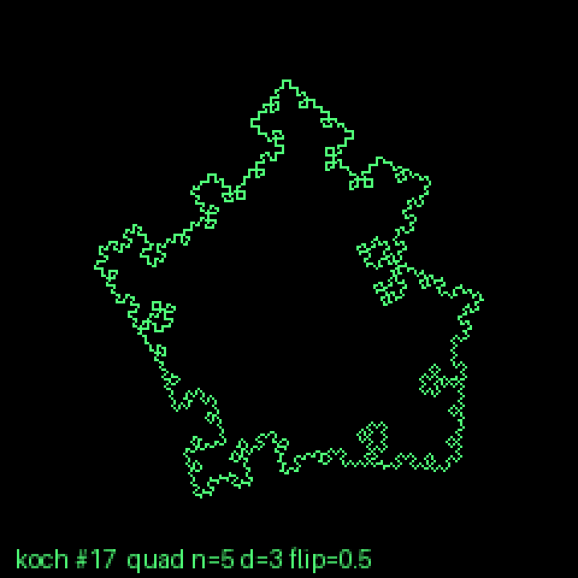

`koch_riff.py --sheet 1 2 3 4 5 6 7 8 9`

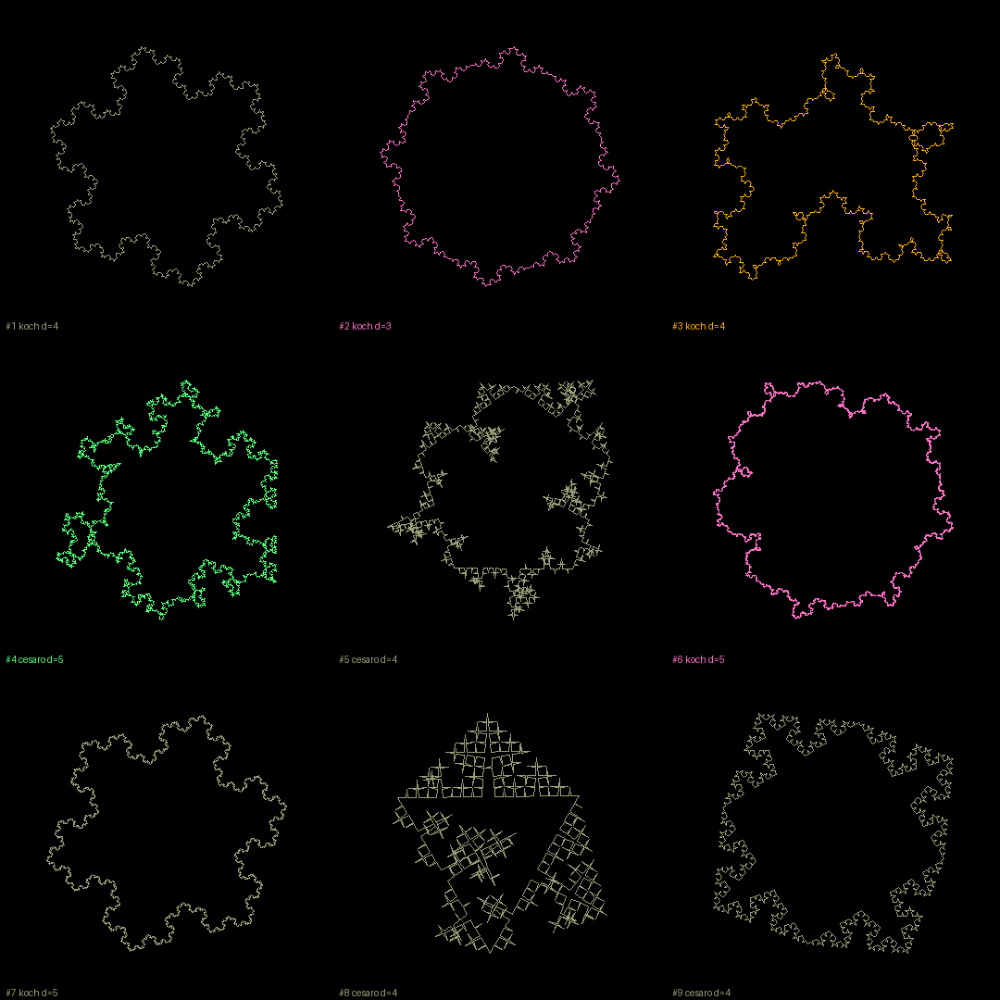

#### pythagoras_tree.py

`pythagoras_tree.py --size 720 6`

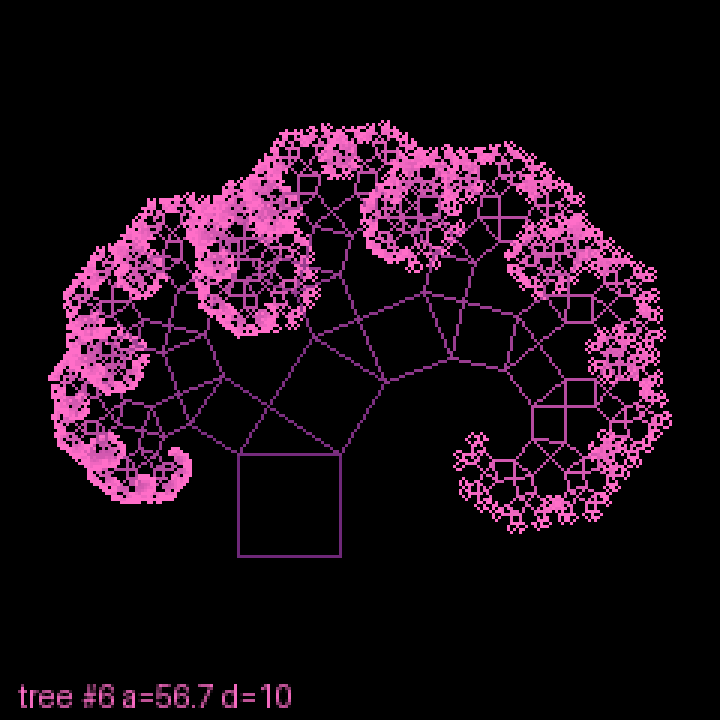

`pythagoras_tree.py --gif --size 540 9`: growing one level at a time

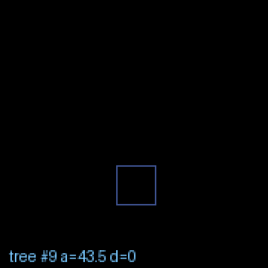

#### attractor.py

`attractor.py --size 720 14`

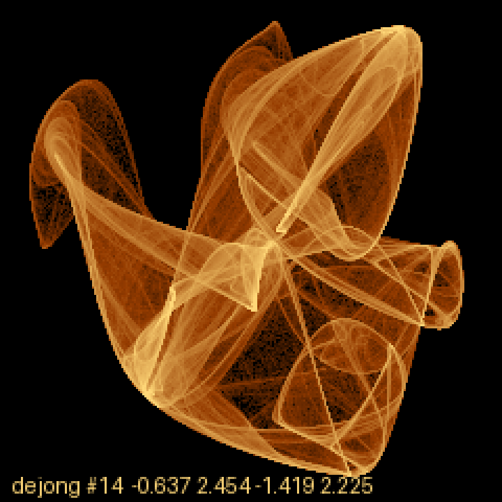

`attractor.py --sheet --size 720 11 13 14 15 17 18 2 5 6`

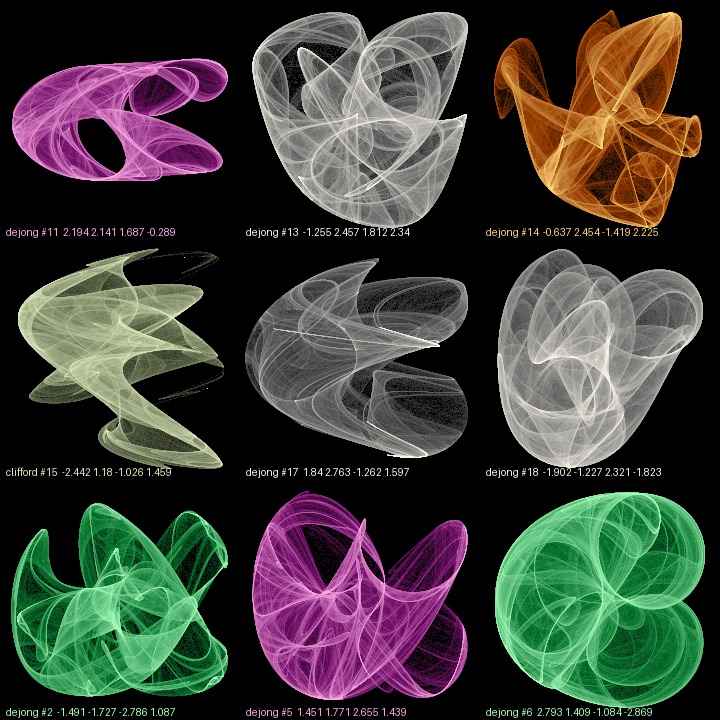

`attractor.py --gif --size 540 11`: points piling up

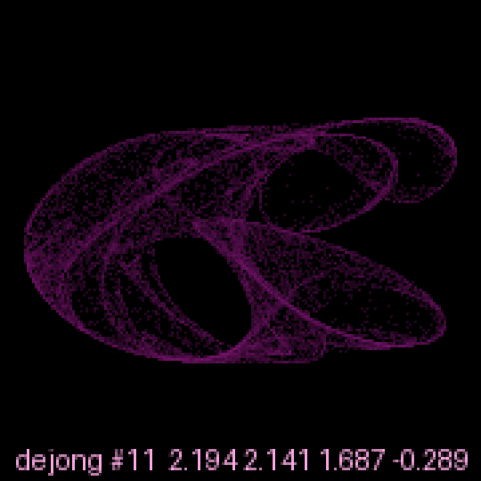

### Mandelbrot zoom video

`zoom_video.py` renders an MP4 that dives from the whole Mandelbrot set to
the spot used by the Andromeda Research demo (−1.74747070750 +
0.00087953063i, magnification 11.1 million). It uses the edge-band look of
`andromeda_zoom.py`: only the boundaries between iteration bands are drawn,
coloured by iteration count, on black. Each frame is rendered at 640×480 and
scaled up 2× with nearest-neighbour, giving a 1280×960, 30 fps video.

It needs NumPy, Numba, Pillow and `ffmpeg` (`sudo pacman -S ffmpeg`). The
Python packages are listed in `python/requirements.txt`, so a virtual
environment is the easiest way to get them:

```sh
cd python
python3 -m venv .venv
.venv/bin/pip install -r requirements.txt
source .venv/bin/activate
```

Then, from `python/`:

```sh
python zoom_video.py                                   # mandel_zoom.mp4, 20 s
python zoom_video.py --turns 1 -o mandel_zoom_spin.mp4  # one clockwise turn
python zoom_video.py --turns 1 --roundtrip -o mandel_roundtrip.mp4  # in and back out, loops
python zoom_video.py --preview 0 0.5 0.8 1             # PNG stills at those points
```

| Option        | Effect                                                                    |
| ------------- | ------------------------------------------------------------------------- |
| `--turns N`   | Rotate the view clockwise N times over the video (default 0)              |
| `--roundtrip` | Zoom in, then back out (twice as long). The rotation keeps going the same way, so the video loops |
| `--preview U ...` | Instead of a video, save `preview_U.png` stills at points U along the zoom (0 = start, 1 = end) |
| `-o FILE`     | Output file (default `mandel_zoom.mp4`)                                   |

The zoom speed is exponential with a smooth start and stop, and the centre
glides onto the target during the first 30% of the dive. The iteration limit
rises from 300 to 1356 as the view narrows. The palette blends from log-scaled
(wide views) to linear (deep views), and each frame's colour range is smoothed
over neighbouring frames so the colours don't flicker.

Rendering takes two passes. The first renders every frame with Numba across
all cores, keeps the iteration counts in a temporary `.iters.tmp` file next to
the output (about 370 MB for the default video, deleted afterwards), and
works out each frame's colour range in worker threads. The second colours the
frames in parallel and pipes them to `ffmpeg`. On a 2-core / 4-thread laptop
the default video takes about 30 seconds and the round trip about a minute.
`ZOOM_WORKERS=N` sets the number of worker threads (default: CPU count).

Stills from along the default zoom, made by
`zoom_video.py --preview 0 0.35 0.8 1` in
[`python/screenshots.sh`](python/screenshots.sh):

<table>
<tr>
<td>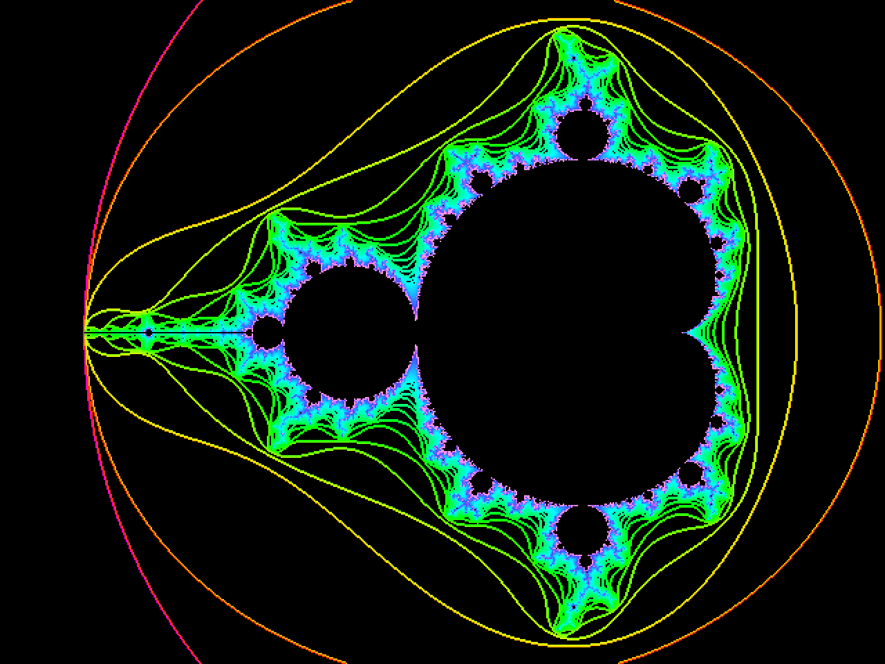</td>
<td>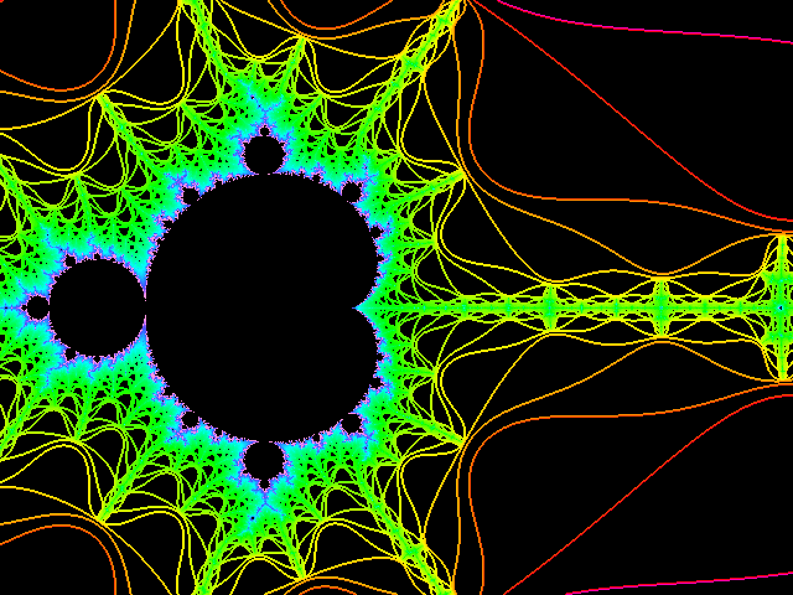</td>
</tr>
<tr><td align="center">0: the whole set</td><td align="center">0.35: heading down the antenna (42×)</td></tr>
<tr>
<td>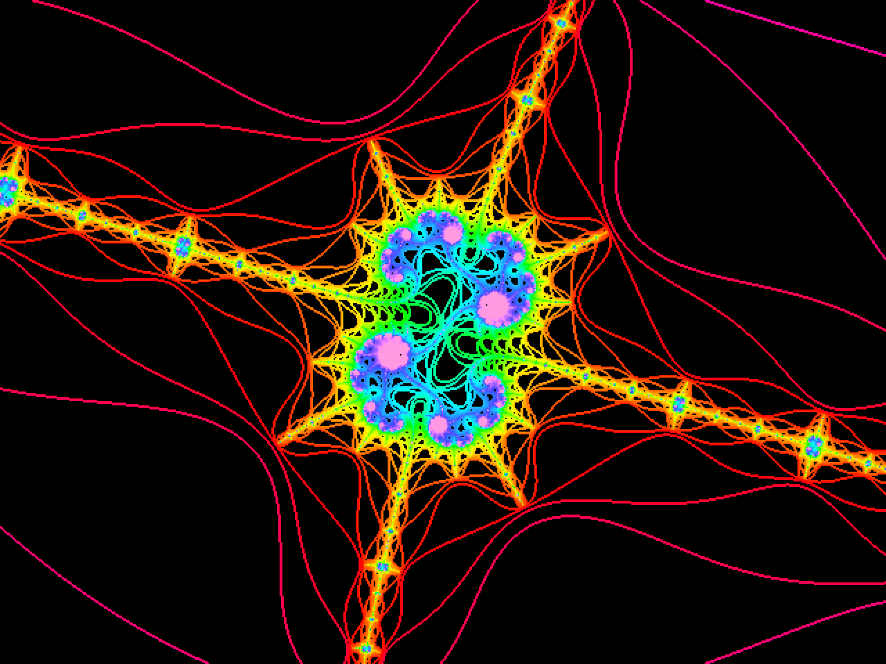</td>
<td>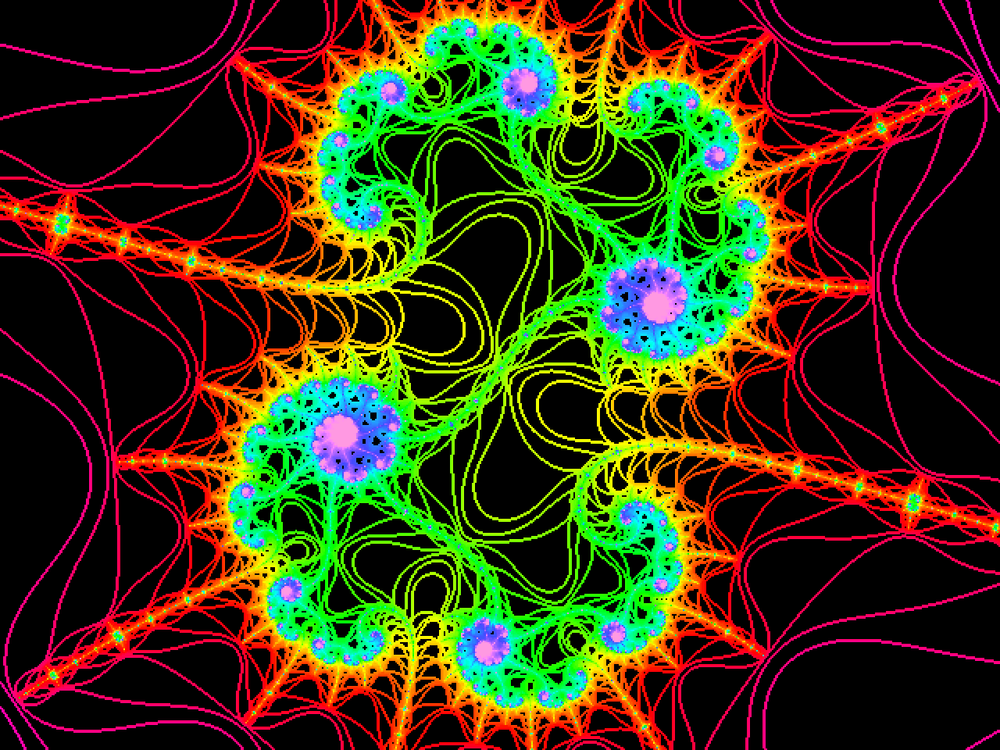</td>
</tr>
<tr><td align="center">0.8: 4.3 million×</td><td align="center">1: the target, 11.1 million×</td></tr>
</table>

`andromeda_zoom.py` renders a single still in the same style:

```sh
python andromeda_zoom.py                               # andromeda_zoom.png at the target
python andromeda_zoom.py --cx -0.65 --cy 0 --mag 0.9 --iter 300 --log -o whole.png
```

## BBC Micro BASIC

Four Mandelbrot programs for the BBC Micro in BBC BASIC, drawn in MODE 2
(160×256 pixels, 8 colours):

| Program   | Listing                               | Draws the picture                                          |
| --------- | ------------------------------------- | ---------------------------------------------------------- |
| `MANDEL`  | [`MANDEL.bas`](bbc/MANDEL.bas)   | a row at a time, from the top and bottom edges inwards     |
| `MANDEL2` | [`MANDEL2.bas`](bbc/MANDEL2.bas) | one big block first, then halving the block size each pass |
| `MANDEL3` | [`MANDEL3.bas`](bbc/MANDEL3.bas) | like `MANDEL2`, with smooth ECF-dithered shading (Master 128) |
| `MANDEL4` | [`MANDEL4.bas`](bbc/MANDEL4.bas) | like `MANDEL`, in 6502 machine code from BASIC's assembler  |

`bbc/mandel.ssd` is an Acorn DFS disc image with all four programs on it.
`MANDEL`, `MANDEL2` and `MANDEL4` run on any BBC Micro. `MANDEL3` needs a
Master 128 (or a BBC with the Graphics Extension ROM) for ECF patterns and
rectangle fill.


They were typed in, run and timed in the
[MacBeeb](https://github.com/acorn-playground/macbeeb) emulator. To run
them in MacBeeb or another emulator such as
[b2](https://github.com/tom-seddon/b2) or [jsbeeb](https://bbc.xania.org/),
load `mandel.ssd` into drive 0 and type:

```basic
CHAIN "MANDEL"
CHAIN "MANDEL2"
CHAIN "MANDEL3"
CHAIN "MANDEL4"
```

Or paste a listing at the `>` prompt and type `RUN`.
Press any key when it's finished to return to MODE 7.

How it works:

- The view runs from −2.2 to 0.98 on the real axis and ±1.28 on the
  imaginary axis, so each pixel covers 0.02 × 0.01 to match MODE 2's wide
  pixels and keep the set round.
- The set is symmetric about the real axis, so it computes only the top
  128 rows and plots each pixel twice, filling in from the top and
  bottom towards the middle.
- Like `mandelbrot5`, it skips points in the main cardioid and the period-2
  bulb with a direct formula, since they would run the full 32 iterations.
- Escaping points are coloured `1 + n MOD 7`, cycling through the seven
  non-black colours. Points that never escape are black.

`MANDEL2` resolves the picture progressively, the way image viewers used to
show a slow download:

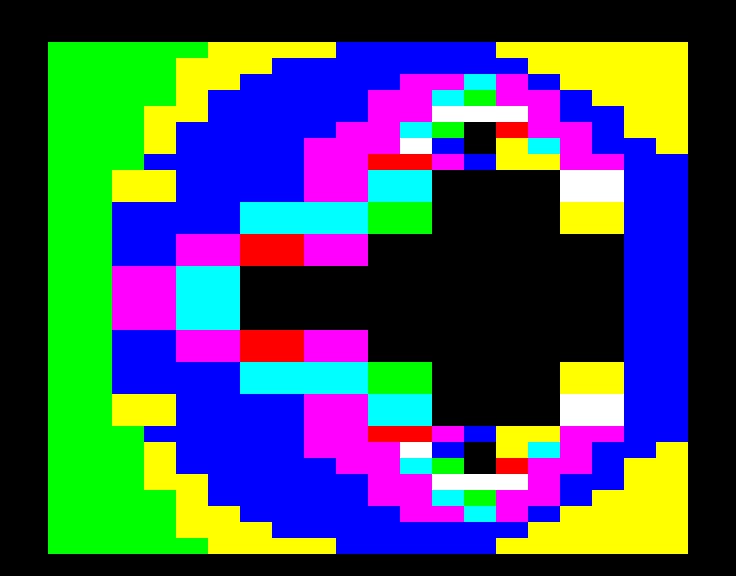


- The first pass works out one point and fills the whole screen with its
  colour. Each later pass halves the block size (256, 128, 64 … 2, 1
  pixels) and fills each block with the colour of its corner point.
- A pass only works out the points that are new. Points on the previous
  pass's grid are skipped, because their blocks are already the right
  colour. So every pixel is still calculated just once.
- OS 1.20 on the Model B has no rectangle fill, so each block is drawn as
  two filled triangles (`PLOT 85`). The last pass plots single points.

The finished picture is the same as `MANDEL`'s. Measured in emulated time
on a 2 MHz Model B, a full screen takes about 39 minutes with `MANDEL` and
about 43 with `MANDEL2`. The extra 4 minutes go on drawing the blocks, but
`MANDEL2` shows a recognisable set within the first minute or so.

### MANDEL3: ECF shading on the Master 128

MODE 2 only has eight solid colours. `MANDEL3` gets smooth gradients from
them with the Master 128's Extended Colour Fill (ECF) patterns, which the
Graphics Extension ROM added to earlier BBCs. It was run on a Master 128
with a Master Turbo (a 4 MHz 65C102 second processor).

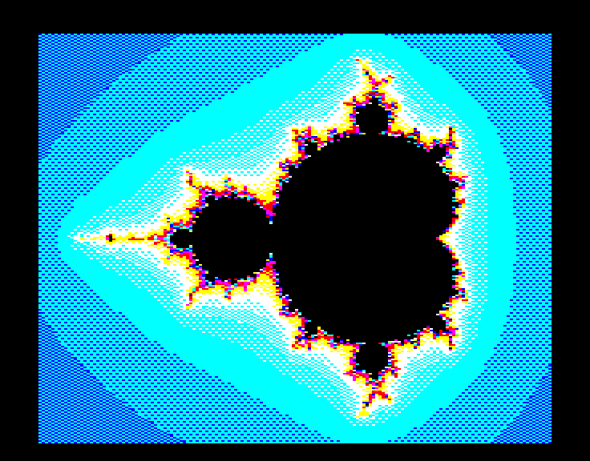

- Like `mandelbrot3` and `mandelbrot4`, it uses escape radius 256 and the
  fractional count `n + 1 − log₂(log|z|)`, with up to 64 iterations.
- The count picks a place on a ramp of blue, cyan, white, yellow, red and
  magenta. Between each pair of neighbouring colours there are three dither
  mixes (25%, 50% and 75%), so the ramp has 24 shades instead of 6.
- A mix is an ECF pattern, defined with `VDU 23,12` as a 2×4 pixel tile of
  the two colours and selected with `GCOL 16,0`. Only one pattern slot is
  used. It's redefined only when the shade changes, which is rarely,
  because neighbouring pixels are usually the same shade.
- The pattern is fixed to the screen, so filling a single pixel with it
  picks out that pixel's colour in the tile. Plotting pixel by pixel still
  gives an even dither.
- It resolves progressively like `MANDEL2`, but draws each block with the
  Master's rectangle fill (`MOVE` then `PLOT 101`) instead of two triangles.
  Big early blocks show the dither too:

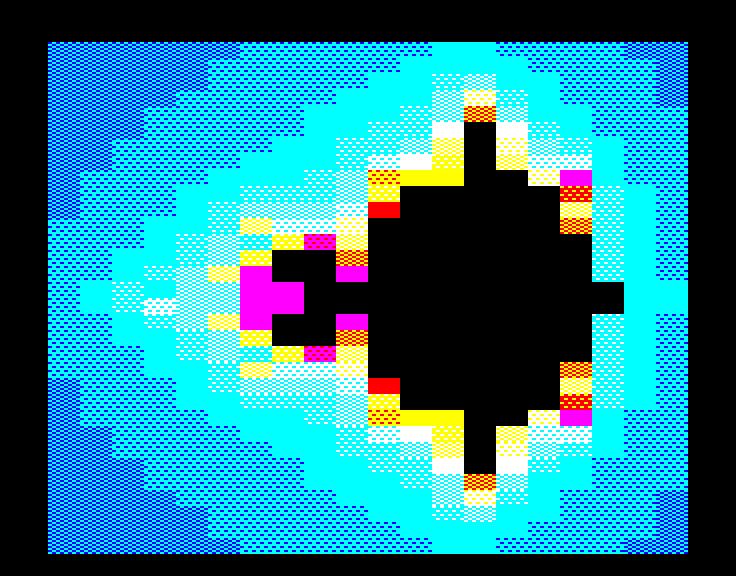

A full screen took about 27½ minutes (emulated time) on the Master Turbo,
despite twice the iterations and a much larger escape radius than
`MANDEL2`.

### MANDEL4: 6502 assembler

`MANDEL4` draws the same picture as `MANDEL`, but the maths runs as 6502
machine code, written with BBC BASIC's built-in assembler (the `[ ... ]`
block). BASIC sets things up, runs the two assembler passes and then
`CALL`s the machine code once per row.

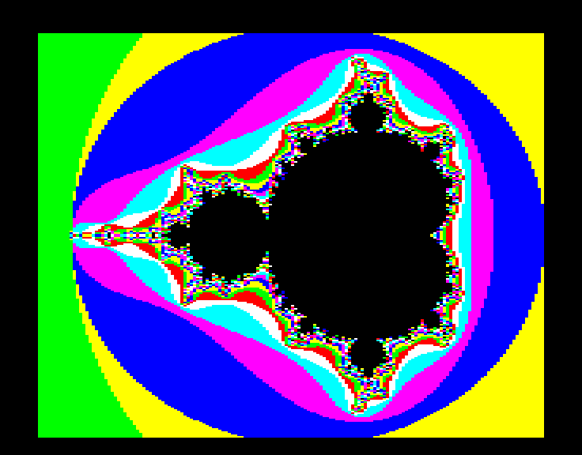

- Numbers are 16-bit fixed point with 12 fractional bits (4.12), so the
  range is ±8 and the resolution 1/4096. The view and colours are
  `MANDEL`'s, with the pixel steps rounded to whole units (82 for 0.02,
  and 40.96 per row computed in BASIC).
- The 6502 has no multiply instruction, so squares come from a
  quarter-square table, `f(n) = n²/4` for n = 0 to 510, which BASIC builds
  at &900–&CFF (two 511-byte tables, low and high bytes). For a 14-bit
  value `v = 256h + l`, `v² = 65536·h² + 512·h·l + l²`, with `h² = f(2h)`,
  `l² = f(2l)` and `h·l = f(h+l) − f(|h−l|)`.
- Each iteration only needs three squares, because
  `2·zr·zi = (zr+zi)² − zr² − zi²`. Before squaring it checks that
  |zr| and |zi| are below 2, which keeps every square in the table's range
  and is also an early escape test.
- Pixels are written straight into MODE 2 screen memory, two to a byte,
  to the row and its mirror image at once. A table converts each colour
  to its bit pattern for the left pixel, and the right pixel is that
  shifted one bit.
- Unlike `MANDEL` it doesn't skip the main cardioid and period-2 bulb, so
  it does all 199,000 or so iterations instead of 89,000.

Rounding in the fixed-point maths changes the escape count of about 4% of
the pixels by one, all near the edge of the set, so the picture is very
slightly different from `MANDEL`'s.

On a 2 MHz Model B it takes **104 seconds**, compared with 39 minutes for
`MANDEL`: about 22 times faster, despite doing more than twice the
iterations.

## Commodore 64 BASIC

Two Mandelbrot programs for the Commodore 64 in BASIC V2, drawn in
multicolour bitmap mode (160×200 pixels, 4 colours):

| Program   | Listing                           | Clears the bitmap with                      |
| --------- | --------------------------------- | ------------------------------------------- |
| `MANDEL`  | [`MANDEL.bas`](c64/MANDEL.bas)   | a BASIC `POKE` loop (32½ seconds)            |
| `MANDEL2` | [`MANDEL2.bas`](c64/MANDEL2.bas) | a 22-byte machine-code routine (`SYS 49152`) |

Apart from the clear they're the same program, and they draw the same
picture as the BBC `MANDEL`: 32 iterations, filling in from the top and
bottom edges towards the middle.

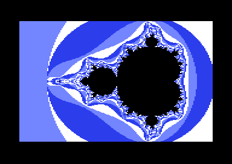

`c64/mandel.d64` is a 1541 disk image with both programs on it. They were
typed in, run and timed in [VICE](https://vice-emu.sourceforge.io/)
(`x64sc`). To run them, attach `mandel.d64` to drive 8 and type:

```basic
LOAD"MANDEL",8
RUN
```

(or `LOAD"MANDEL2",8`). Press any key when it's finished to get back to
the text screen, which shows the drawing time in seconds.

The listings are in upper case for readability. To build a `.prg` from one
with VICE's `petcat`, lower-case it first, since petcat reads unshifted
PETSCII as lower case:

```sh
tr 'A-Z' 'a-z' < c64/MANDEL.bas | petcat -w2 -o mandel.prg --
```

How it works:

- BASIC V2 has no graphics commands, so everything is `POKE`s. Lines
  60–70 turn on bitmap mode (53265), multicolour mode (53270) and point
  the VIC-II at a bitmap at 8192 (53272). `POKE 55,0:POKE 56,32:CLR` on
  line 20 lowers the top of BASIC memory so variables can't grow into the
  bitmap.
- In multicolour mode each byte holds four 2-bit pixels. Bit pair `00` is
  the background colour (black, for inside the set). `01` and `10` come
  from the cell's byte in screen RAM (blue and light blue), and `11` from
  colour RAM (white). Line 80 sets every cell to the same three colours.
- The bitmap is laid out in 8×8 character cells, not scan lines, so the
  byte for pixel (x, y) is `8192 + INT(y/8)*320 + INT(x/4)*8 + (y AND 7)`.
  The pixel's bits are ORed into that byte, with the shift looked up in
  `W()`.
- The view runs from −2.48 to 0.95 on the real axis and ±1.14 on the
  imaginary axis. Each pixel covers 0.0216 × 0.0115, because multicolour
  pixels are about twice as wide as they are tall.
- Escaping points are coloured `1 + n MOD 3`. BASIC V2 has no `MOD`, so a
  table `K()` is filled in with `I-INT(I/3)*3` at the start.
- The speed tricks are standard C64 ones. The variables used most are
  defined first on line 30, because BASIC V2 finds variables by searching
  them in the order they were created. Constants like 4 live in
  variables, because BASIC re-parses a number from its text every time it
  meets one. The inner loop is one line ending `IF A+B<F THEN NEXT`: when
  the point escapes, the `IF` fails and execution drops to the next line,
  leaving `N` as the escape count.

Measured with the C64's `TI` jiffy clock on a PAL machine, the drawing (not
counting the clear) takes 4056 seconds, about **67½ minutes**, compared
with 39 minutes for the BBC `MANDEL` on a 2 MHz Model B. BASIC V2's
floating point is slower than BBC BASIC's, the C64's 6510 runs at
0.985 MHz, and working out each pixel's address in BASIC costs more on top.
`MANDEL2`'s clear takes a fraction of a second instead of 32½ seconds, but
its drawing takes 4096 seconds, 40 seconds longer, so overall it comes out
slightly slower. Its `READ D` creates one more variable before the drawing
starts. BASIC V2 searches variables in the order they were created, so
every variable made after `D` (`T0`, `Y`, `C2`, `Q`, `V`, `O`) is a little
slower to find, and that adds up over the whole picture.

## Blog posts

I've written about this repo as it grew, on my blog
[0x32](https://blog.0x32.co.uk/):

- [Vibe Coding Mandelbrots in Pascal](https://blog.0x32.co.uk/posts/vibe-coding-pascal-fractals/):
  the first four Pascal programs, from plain ASCII to truecolor half blocks.
- [Retro Fractal Zoom](https://blog.0x32.co.uk/posts/retro-fractal-zoom/):
  the retro-styled Mandelbrot zoom video.
- [More Fractals: An Interactive Explorer and Some Python](https://blog.0x32.co.uk/posts/more-fractals-explorer-and-python/):
  the `mandelbrot5` explorer and the Koch, Pythagoras-tree and attractor scripts.
- [The Fractal Zoom Video, Now in the Repo](https://blog.0x32.co.uk/posts/fractal-zoom-video-script/):
  `zoom_video.py`, its spin and round-trip options, and making it faster.
- [Mandelbrots on the BBC Micro](https://blog.0x32.co.uk/posts/bbc-micro-mandelbrot/):
  the three BBC BASIC programs in `bbc/`, ECF shading on the Master 128,
  and how long they really take.
- [A BBC Owner's Mandelbrot on the Commodore 64](https://blog.0x32.co.uk/posts/c64-mandelbrot/):
  the two C64 BASIC programs in `c64/`, as seen by someone who grew up
  on BBC BASIC.

And about the related repos listed under [Links](#links):

- [Vibe Coding fractalPy with Claude](https://blog.0x32.co.uk/posts/fractalpy/):
  building [fractalPy](https://github.com/alastairhm/fractalPy).
- [Generative Art with Context Free](https://blog.0x32.co.uk/posts/contextfree-generative-art/):
  the [ContextFree](https://github.com/alastairhm/ContextFree) scripts.
- [Raspberry Pi Pico W Mandelbrot Set](https://blog.0x32.co.uk/posts/pico4/):
  the Mandelbrot scripts in [pico_w](https://github.com/alastairhm/pico_w).

## Links

My other generative-art, fractal and Pascal repos:

- [fractalPy](https://github.com/alastairhm/fractalPy): a small
  Numba-accelerated Mandelbrot set renderer in Python.
- [ContextFree](https://github.com/alastairhm/ContextFree): scripts for
  [Context Free Art](https://www.contextfreeart.org/), a grammar for
  generating images from drawing rules, with their rendered output and a
  Docker image to run them.
- [processing](https://github.com/alastairhm/processing): sketches for
  [Processing](https://processing.org/): Truchet tiles, circle and
  rectangle filling, pixel painting and shapes.
- [pascal](https://github.com/alastairhm/pascal): Adventures in Pascal,
  relearning Pascal with [Free Pascal](https://www.freepascal.org/) by
  working through exercises from classic Pascal books.
- [pico_w](https://github.com/alastairhm/pico_w): MicroPython examples for
  the Raspberry Pi Pico W, including a Mandelbrot set in ASCII
  (`mandelbrot.py`) and on an OLED display (`mand_oled.py`).

## License

MIT. See [LICENSE.md](LICENSE.md).
